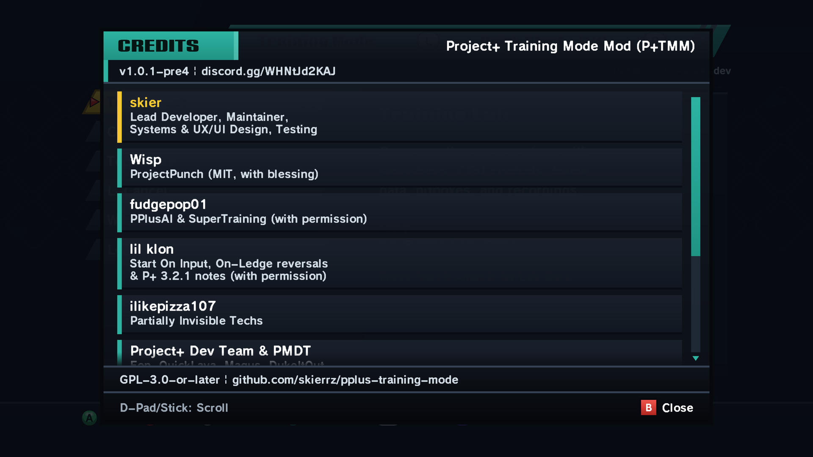

# Credits

Project+ Training Mode Mod (P+TMM) builds on years of reverse engineering, tooling, and training-mod work by the Project+ and Brawl modding communities. This page lists every contributor and upstream project P+TMM draws on, what is used, and how.

You can also view credits directly inside the mod by pressing **Z** on the CSS Boot Menu (`+` on Classic, `1` on Nunchuk, `- + 2` on Sideways Wii Remote) or selecting **Credits** at the bottom of the in-match Lab Menu's left rail.

  

Each upstream section notes how the material is used:

- **Copied:** Text or code taken directly, sometimes edited.
- **Adapted:** An algorithm, rule, layout, or data table re-implemented from reading the upstream source.
- **Called in the game:** P+TMM invokes or reads another project's code or data at runtime.
- **Learned from:** Documentation, symbol maps, or source studied to understand Brawl and Project+.
- **Built or tested with:** Compilers, linkers, emulators, and scripts used to build or verify the mod.

For the exact file-by-file attribution table and license texts, see [THIRD_PARTY_NOTICES.md](THIRD_PARTY_NOTICES.md).

## Project Maintainer

- **skier** - Lead Developer, Maintainer, Systems & UX/UI Design, Testing.

## ProjectPunch

[ProjectPunch](https://github.com/WispSSBM/ProjectPunch) by **Wisp** is the pioneering Project+ training plugin (MIT license). Because Project+ does not have enough memory to run both plugins simultaneously, P+TMM carries over ProjectPunch's core training tools with Wisp's blessing.

- **Adapted:** Frame advance and its hold delay; freezing game tasks during frame advance; fighter status and animation-command tracking; on-hit and on-shield frame advantage and tolerance; ledgedash and wavedash tracking, GALINT, and the ledgedash frame bar; color overlays and the **Standard (PPunch)** overlay preset; the invisible-tech trainer; and the fighter-state rows of the Info Display.

ProjectPunch's invisible-tech trainer draws on **ilikepizza107**'s "Partially Invisible Techs" script (GameBanana script 12025).

## lil klon

**lil klon**, a ProjectPunch contributor, built recording, playback, and reversal tools for ProjectPunch's training dummy and shared his source and Project+ 3.2.1 research notes with permission to adapt with credit.

- **Adapted:** **Start On Input** recording arming (holding capture until the first non-neutral controller input, with an Armed HUD state); **On-Ledge** reversal triggers on actionable `Cliff_Wait` (`0x75`) frames (respecting counter delay while leaving `Cliff_Catch` startup untouched) in `src/main/cpu/ledge_logic.h`, `src/main/cpu/options.cpp`, and `src/main/cpu/options_counters.hpp`; and weighted multi-slot **Reversal Slots** across On-Hit, On-Shield, On-Getup, and On-Ledge triggers.
- **Learned from:** His notes on Project+ 3.2.1 dummy edge cases (crouch-cancelled hits, forced dummy inputs leaking into menus, and Training pause menu state).

## fudgepop01 (PPlusAI and SuperTraining)

**fudgepop01** authored [PPlusAI](https://github.com/fudgepop01/PPlusAI) and the SuperTraining / FudgeMenu training suite inside [ProjectMCodes](https://github.com/Fracture17/ProjectMCodes), and gave express permission for P+TMM to adapt those algorithms with credit.

- **Adapted:**
  - 44-fighter Project+ recovery framework (`103_recoveryHub.as` per-fighter geometry, 8 recovery families, 360-aim dead-zone notch clamping, high-recovery mixups, glide/B-reverse/tether/float/PK Thunder orbit rules, and stack-only `WeightedDie`), re-implemented in pure C++ in `src/extra/pplus_recovery*`.
  - Combo Trainer backend (`noclip` auto-reset, `comboTimerAdjustment`, random position/damage resets, `recoveryTrainer` loop, and 7 floating world-space state meters), adapted onto Project+ 3.2.1 APIs in `src/extra/combo_trainer*`.
  - Hitbox Heatmap trail ring-buffer accumulation, actionable-ground frame-age color bands, opacity/bounds controls, and live reach-bounds design in `src/extra/hitbox_heatmap*` (rendering through stock Project+ 3.2.1's `soCollision::getShape` and debug bubble routines).
  - Adaptive CPU backend (`MovementTracker` 128-entry similarity-weighted Markov action tracker and `PatternManager` 15-entry weighted RPS habit tracker, with wrap-around and start-index fixes) in `src/extra/adaptive_cpu*`.
  - Read-only PSA AnimCmd 11-Thread & FSM Inspector concept (`PSADataPage` / `PSAScriptPage` thread table and frame speed modifier readout) plus AnimCmd module prefixes, opcode names, and typed argument decoding specification, re-implemented from scratch on Project+ 3.2.1 runtime structures in `src/extra/psa_inspector*` and `src/extra/psa_opcodes*`.
- **Learned from:** SuperTraining's animation-command thread structures, studied alongside Brawl's own code when building `src/extra/frame_data.cpp`.

## Project+ and PMDT

[Project+](https://projectplusgame.com) by the **Project+ Development Team** (building on the **Project M Development Team** and **Legacy TE** team) is the game P+TMM runs on. Author names below follow the code headers in Project+'s source.

**Called in the game:**

- Hitbox, hurtbox, and stage collision debug drawing and debug color table: **Eon**.
- ECB collision debug drawing: **Arthur** and **Eon**.
- Code Menu (originally by **Fracture** for Legacy TE, maintained for Project+ by **QuickLava**): read by DI Display for SDI/ASDI distances, and guarded cleanly inside Training.
- Syriinge plugin loader shipped with Project+: **Sammi Husky** and **DukeItOut**.
- SD card file patch enabling `/Project+/tm/` storage: **Sammi Husky**.
- Extra fighter information block (`ECB Lock`): **Magus** and **DukeItOut**.

**Project+ rules modeled directly by P+TMM:**

- Directional Influence (trajectory DI, stick scaling, C-stick ASDI, grounded ASDI-Down, DI below tumble): **Magus**, **DukeItOut**, and **Dantarion**.
- Analog stick cap/multiplier and analog C-stick/trigger variables: **Magus** and **DukeItOut**.
- L-cancelling and landing checks: **Eon**, **Magus**, **Standardtoaster**, **wiiztec**, **DukeItOut**, and **mawwwk**.
- Powershielding and projectile reflection: **Shanus**, **Magus**, and **DukeItOut**.
- Hitstun, tumble, tech windows, wall/ceiling tech in hitlag, slow-turn dashback, jump-cancelled grabs, and grab release rules: **Magus**, **Shanus**, **DukeItOut**, **Eon**, and **Phantom Wings**.
- Instant fastfalls: **fudgepop01** and **DukeItOut**.
- Airdodges, wavedash landings, stage ray checks, and Training move staling: **Eon** (with stale move ratios and hitstun multiplier by **spunit262** and **Phantom Wings**).
- Training CPU options, debug pause, boot-to-CSS, alternate stages, stage files, camera, replays, Hold Start to pause, LA variable expansion, music selection, and item clone engine: **Eon**, **PyotrLuzhin**, **QuickLava**, **Magus**, **fudgepop01**, **DukeItOut**, **Sammi Husky**, **Kapedani**, **Fracture**, **standardtoaster**, **Squidgy**, and **mawwwk**.
- Fighter scripts, parameters, and RNG mechanics (Peach turnips/F-Smash, Luigi misfire, Mr. Game & Watch Judge, and fighter charges/resources): Project+ fighter scripts and parameters.

No Project+ game files are included in this repository; you must provide your own Project+ v3.2.1 build.

## Syriinge and SyriingePluginTemplate

[Syriinge](https://github.com/Sammi-Husky/Syriinge) by **Sammi Husky** loads C++ plugins inside Brawl, and [SyriingePluginTemplate](https://github.com/Sammi-Husky/SyriingePluginTemplate) (MIT) provided the initial build layout.

- **Copied:** Syriinge 0.6.0 SDK headers (`lib/sy_core/include/`) and linker script (`link/rel.lcf`).
- **Adapted:** `Makefile` flags, `link/EXTRA.lst` format, and REL entry points.
- **Called in the game:** Syriinge loads the stub and installs hooks.
- **Built with:** CodeWarrior 4.2 and [elf2rel](https://github.com/Sammi-Husky/elf2rel) fetched by `make tools`.

## doldecomp/brawl and BrawlHeaders

The [Brawl decompilation](https://github.com/doldecomp/brawl) (CC0) and [BrawlHeaders](https://github.com/Sammi-Husky/BrawlHeaders) provide the game's class layouts, headers, and RSBE01 rev 2 symbol maps.

- **Learned from:** Decompilation source and RSBE01 rev 2 symbol maps.
- **Built with:** Compiled against `lib/BrawlHeaders` headers and linked with `RSBE01.lst` plus symbol addresses recorded in `link/EXTRA.lst`.

## Brawl Online and Brawlback

[Brawl Online](https://brawlonline.net) ([source](https://github.com/sarahkittyy/brawlonline.net)), built on [Brawlback](https://github.com/Brawlback-Team) (**WhiteTPoison**, **PiNE / FaultyPine**, **Kapedani**, **eliasreid**, **rapito**, **Believer1**, and contributors), provides the Dolphin test build and informed the savestate memory ranges and packed-module loader approach. Material from Brawl Online is used with permission from its maintainer, **sarahkittyy**.

- **Built or tested with:** Brawl Online's Dolphin fork (forked from Brawlback's `Project-Plus-Dolphin`, GPL-2.0-or-later) and its automation harness protocol.
- **Adapted:** Fixed savestate memory ranges (`src/main/savestate/snapshot.cpp`) from Brawl Online's rollback range lists; CSS/SSS test offsets and FAT32 test image helper layout (`scripts/nav.py`, `scripts/fatimage.py`).
- **Learned from:** Inline-hook stub restore order repair and multi-module packed REL loading from `PPOnlineLoader` (MIT, forked from `brawlback-asm`).

## Other Community References

- **[ProjectMCodes](https://github.com/Fracture17/ProjectMCodes)** by **Fracture17** (**learned from**): Brawl function-name maps studied while researching DI, menus, and CPU control (SuperTraining algorithms by **fudgepop01** are credited above).
- **[BrawlRE](https://github.com/BrawlRE/BrawlRE.github.io)** (MIT, **learned from**): Brawl item kind and Peach turnip parameter tables.
- **[PowerPC-Assembly-Functions](https://github.com/QuickLava/PowerPC-Assembly-Functions)** by **QuickLava** (**learned from**): Code Menu and Draw DI reference checked against DI Display.

## Development Tools

- **Metrowerks CodeWarrior 4.2** for Wii (`mwcceppc`, `mwldeppc`) and `elf2rel` (fetched externally by `make tools`, not stored in this repository).
- **[devkitPro](https://devkitpro.org)** MSYS2 (`make` and POSIX shell utilities on Windows).
- **[Dolphin](https://dolphin-emu.org)** (via Brawl Online's build) for automated verification.
- **[Python](https://www.python.org)** and **[Pillow](https://python-pillow.org)** for module packing, code generation, and test assertions.

## Missing or Wrong Credit?

If your work is used here and is missing or credited inaccurately, please open a [GitHub Issue](https://github.com/skierrz/pplus-training-mode/issues) or reach out on the [P+TMM Discord](https://discord.gg/WHNtJd2KAJ) and it will be fixed promptly.
