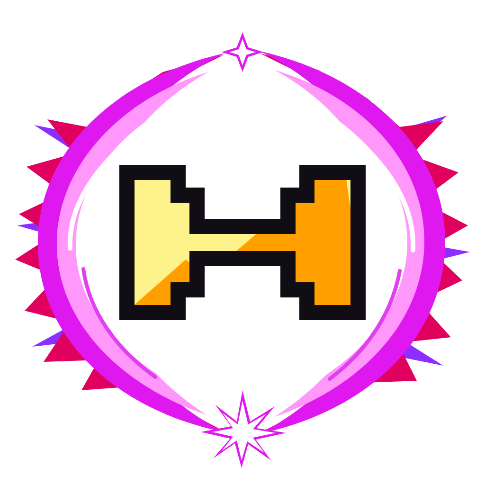
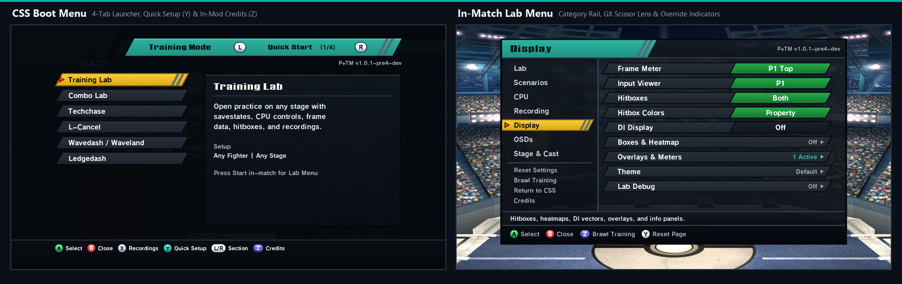
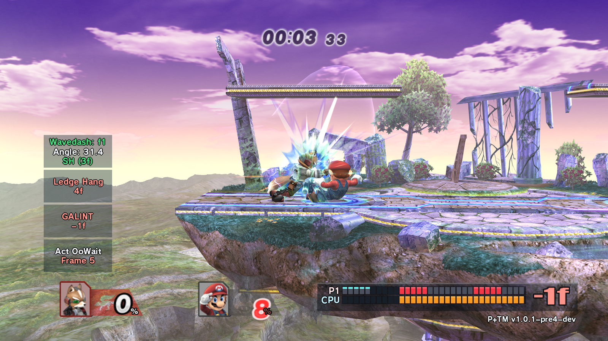

<div align="center">



# Project+ Training Mode Mod (P+TMM)

A free, open-source training lab plugin for **Project+ v3.2.1** that expands Brawl's Training mode with savestates, multi-slot input recording, programmable CPUs, practice scenarios and drills, frame data, and visualizers.

[](https://github.com/skierrz/pplus-training-mode/releases)
[](https://discord.gg/WHNtJd2KAJ)
[](https://projectplusgame.com)
[](LICENSE)

</div>

> [!IMPORTANT]
> **Discord Server:** Join the **[P+TMM Discord](https://discord.gg/WHNtJd2KAJ)** for test builds, bug reports, setup help, and shared `.tmr` recordings.

> [!NOTE]
> **AI Use and Credits:** P+TMM is developed with AI assistance and builds on years of foundational Project+ and Brawl modding work. Every feature is backed by Project+ 3.2.1 source research, native Wii GX UI design, automated Dolphin and Wii-compatibility testing, and hands-on playtesting. [Read the full disclosure and credits](#ai-use-and-credits).

<p align="center">
  
</p>

<p align="center">
  
</p>

---

## Installation

### Option 1: Prebuilt Dolphin / Packed SD (Recommended for Dolphin)

1. Download the prebuilt Dolphin package (or pre-packed `sd.raw`) from [Releases](https://github.com/skierrz/pplus-training-mode/releases) or the [P+TMM Discord](https://discord.gg/WHNtJd2KAJ).
2. Extract it, point Dolphin at your Super Smash Bros. Brawl (USA, `RSBE01` rev 2) ISO, and launch Project+.

### Option 2: Add to an Existing Project+ v3.2.1 Build (Dolphin or Wii)

Download `TrainingMode.rel` from [Releases](https://github.com/skierrz/pplus-training-mode/releases) and copy it into `Project+/pf/plugins/` on your SD card.

- **Dolphin (`sd.raw`):** Open **Options -> Configuration -> Wii -> SD Card Settings**, enable **Insert SD Card** and **Allow Writes to SD Card**, click **Unpack SD Card Now**, copy `TrainingMode.rel` into `Project+/pf/plugins/`, then click **Pack SD Card Now**.
- **Wii:** Copy `TrainingMode.rel` directly into `Project+/pf/plugins/` on your SD card.

Delete `TrainingMode.rel` to uninstall. No other files in your Project+ build are modified. See [docs/install.md](docs/install.md) for the full setup walkthrough.

> **Note on ProjectPunch:** Project+ does not have enough memory to load P+TMM alongside [ProjectPunch](https://github.com/WispSSBM/ProjectPunch), so keep only one plugin in `Project+/pf/plugins/` at a time. P+TMM builds on Wisp's MIT-licensed ProjectPunch work (with Wisp's blessing) and carries over its core training tools (frame advance, ledgedash/GALINT HUD, color overlays, invisible techs, and frame advantage) so you keep those features when switching.

### Requirements

- **Project+ v3.2.1**
- **Super Smash Bros. Brawl** (USA, `RSBE01` rev 2) disc image
- **Dolphin** or **Wii** (Dolphin is the primary test target; Wii compatibility is actively maintained via strict MMU, DSP LLE, and heap checks, though real Wii hardware is not yet thoroughly tested)
- **Offline play only** (do not use on netplay)

---

## Controls

GameCube, Classic Controller, Wii Remote + Nunchuk, and Sideways Wii Remote are all supported across the Boot Menu, Quick Setup, Recordings Browser, In-Mod Credits, and in-match Lab controls.

### Character Select (Boot Menu)

| Action | GameCube | Classic | Nunchuk | Sideways Wii Remote |
|---|---|---|---|---|
| Boot to Versus instead of Training | Hold `X` or `Y` | - | - | - |
| Switch tabs (`Quick Start`, `Scenarios`, `Tech Practice`, `Minigames & Tech`) | `L` / `R` | `L` / `R` (`ZL` / `ZR`) | `-` / `+` | `-` / `+` |
| Open Quick Setup (overlays and OSD presets) | `Y` | `Y` | `Z` | `- + A` |
| Open Recordings Browser (`.tmr` files on SD) | `X` | `X` | `C` | `A` |
| Open In-Mod Credits Modal | `Z` | `+` | `1` | `- + 2` |
| Close menu to CSS / Hold to exit to Solo menu | Tap / Hold `B` | Tap / Hold `B` | Tap / Hold `B` | Tap / Hold `1` |
| Reopen Boot Menu from CSS | `L + R` | `L + R` | `C + Z` | `- + B` |

### In-Match

| Action | GameCube | Classic | Nunchuk | Sideways Wii Remote |
|---|---|---|---|---|
| Open / Close Lab Menu | `Start` | `+` | `+` | `+` |
| Open Brawl's Training menu (from Lab Menu) | `Z` | `ZL` / `ZR` | `Z` | `-` |
| Save / Load Savestate | Hold `D-Pad Right` / Tap `D-Pad Left` | Hold `D-Pad Right` / Tap `D-Pad Left` | Hold `D-Pad Right` / Tap `D-Pad Left` | Hold `- + D-Pad Right` / `- + D-Pad Left` |
| Switch Drill Mode (`Free Practice` / `10-Rep Set` / `20-Rep Set` on drills; `60s` on challenge modes; `Free` / `30s` / `60s` on Break the Targets!) | `L + D-Pad Up` | `L + D-Pad Up` | `C + D-Pad Up` | `- + D-Pad Up` |
| Reset highlighted option / Reset current page (in Lab Menu) | `X` / Double-tap `Y` | `X` / Double-tap `Y` | `-` (option) / Double-tap `-` on rail (category) | Use `Reset Settings` |

- **Lab Menu layout & Credits:** Category Rail is the default style (opening focused on the left category rail, with a hardware `GXSetScissor` highlight lens and emerald override pills). Switch between **Category Rail** and **Top Tabs** under **Lab > Controls > Menu Style**, or select **Credits** at the bottom of the left rail to open the scrollable In-Mod Credits Modal.
- **Keep `Start` for Brawl's pause menu:** Set **Lab > Controls > Menu Open** to **Z in Pause**, then open the Lab Menu from Brawl's pause menu (`Z` on GC/Nunchuk, `ZL`/`ZR` on Classic, `-` on Sideways).
- **P+ Code Menu shortcut (`L + R + D-Pad Down`):** Disabled by default inside Training to avoid shortcut conflicts. Re-enable it under **Lab > Controls > P+ Code Menu Shortcut**. Main Menu access and regular Versus matches are unchanged.

---

## Features

### Practice Modes and Drills

Launch **Training Lab** for an open sandbox, or pick a ready setup from the 4-tab Boot Menu:

- **Scenarios:** 9 unified Project+ setups running directly on the lab engine (**Combo Lab**, **Techchase**, **Edgeguard**, **Shield Pressure / OoS**, **Shield Drop**, **Ledgetech**, **Slide-Off**, **Grab Defense / Throw DI**, **P+ Multi-Hit SDI**) plus the **CC / ASDI-Down** drill. Scenario settings are temporary and never overwrite your saved SD config.
- **Tech Practice (7 drills):** Guided drills tracking live hit rate, streaks, SD-saved best streaks, and timing/angle/GALINT readouts (**L-Cancel**, **Wavedash / Waveland**, **Ledgedash**, **Powershield**, **RAR**, **DACUS**, **B-Reverse / Wavebounce**).
- **Minigames & Character Trainers:** **Break the Targets!**, **Float / Hover & DJC** (6-fighter cast: Peach, Mewtwo, Ness, Lucas, Yoshi, Ganondorf), and **Snake C4 Recovery**.

### Savestates and Input Recording

- **Savestates:** Save and load cleanly mid-attack, in hitlag, during grabs, on ledge, and with projectiles or Ice Climbers active (two players at most). Supports optional random percent variance on load.
- **6-Slot Recording (P1 and CPU):** Savestate-backed deterministic playback with **Start On Input**, weighted random slot playback, mirrored playback, looping, live takeover/re-record, per-frame input editing (**Slot Management > Alter Inputs**), Frame Rewind, and `.tmr` SD export/import (`/Project+/tm/`).

### Programmable CPU and Combo Trainer

- **44-Fighter P+ AI Recovery:** Pure C++ offstage recovery covering all Project+ recovery families.
- **Counter Pools & Reversals:** Trigger counters on hit, on shield, in the air, or on ledge (`Cliff_Wait`) with custom delays, **Custom Pools**, weighted **Reversal Slots**, 10-hit **Per-Hit Counters** tables, **SHFFL / FFL** pressure, and **Adaptive CPU** habit tracking.
- **DI, Techs & Combo Trainer:** 10 P+ DI modes (including live 2D **Custom** stick aiming, **Survival**, **Combo**, and **Down & Away**), SDI, **Dual-Stick SDI**, ASDI, weighted tech/getup mixups, invisible techs, bury/stun mashing, and hitstun-drop **Combo Trainer** auto-resets.

### Frame Data, Visualizers, and OSDs

- **Unified Frame Meter (`Display > Frame Meter`):** Dual-row SF6-style live timeline (`P1 Top` / `CPU Top`) displaying startup, active strikes, active grabs/tethers, vulnerable lag/recovery/landing, stun/hitlag, intangibility/GALINT, and signed frame advantage, color-synced with the Ledgedash HUD and Floating Meters.
- **Visualizers:** Native P+ hitboxes/hurtboxes (with **Default**, **Property**, and **Priority** color modes), **Hitbox Heatmap** with reach bounds, 3D **Grab / Tether Boxes**, real-time **DI Display** trajectory preview, multi-controller **Input Viewer**, **Color Overlays** (including the **Standard (PPunch)** preset), 34-field **Info Display** (up to 8 rows per fighter), and a read-only **PSA Debugger** (11-thread & FSM Inspector).
- **20 Barless FIFO On-Screen Displays:** Compact chronological FIFO cards with smooth stack glide and fade-out, built-in presets (**Essentials**, **Movement**, **Defense**, **All Off**), and 3 saveable **Custom 1-3** slots.
- **Colorblind Mode:** Built-in **Display > Theme > Colorblind Mode** (`Off`, `Deuteran`, `Protan`, `Tritan`) across OSDs, Frame Meter, Ledgedash HUD, Drill HUDs, and Floating Meters.

<details>
<summary>Full list of 20 On-Screen Displays</summary>

- **Wavedash** (timing, angle, and short-hop frames)
- **L-Cancel** (with P+ Auto L-Cancel rule awareness)
- **Ledgedash Info** (GALINT, frames on ledge, angle, and P+ 5-ledgegrab limit tracking)
- **Act OoS** (action out of shieldstun)
- **Shield Advantage** (with PSA script lookahead)
- **Hit Advantage**
- **Dashback** (direct, P+ Slow Turn, and failed)
- **Powershield** (physical, reflect, and Light->Hard)
- **Act OoLag**, **Act OoAirborne**, and **Act OoHitstun**
- **Jump Cancel** and **Fastfall Timing**
- **Boost Grab / DACUS** (including hitlag Gatling DACUS)
- **SDI Inputs**, **Tech Lockout**, **Combo Counter**, **Mash Out**, **Item Throw** (including Glide Toss), and **P+ Tech OSD**

</details>

### Stage, Cast, and Character Tools

- **Mid-Match Swaps & Stage Control:** Switch fighters and costumes without leaving the match, toggle stage hazards, and control moving platforms (including Fountain of Dreams left/right heights).
- **Olimar Lab Kit & 18-Fighter RNG Controls:** Live `B+D-Pad Pluck`, 16 `Lineup Presets`, 5-color Pull Pool toggles, Whistle / Lead targeting + `Move Lead Now`, global and per-color Maturity locks, 4-slot Starting Lineup, and dedicated RNG/resource controls for 18 fighters.
- **4-Player & Offline VS Displays:** Full 4-player Training support plus optional read-only displays in local Offline VS (**Display > Overlays & Meters > Offline VS Displays**, with Assist Trophies off).

<details>
<summary>Supported character RNG and mechanics controls (18 fighters)</summary>

Peach (Turnip, F-Smash, Float), Luigi (Misfire), Mr. Game & Watch (Judge, Oil Panic), Samus (Charge, Beam, Air Bombs), Mewtwo (Shadow Ball, Hover), Lucario (Aura, Sphere), Wario (Waft), Donkey Kong (Giant Punch), Ivysaur (Solarbeam), R.O.B. (Air Boosts, Gyro Charge, Beam), Lucas (Offense Up), Squirtle (Water Gun), Sheik (Needles), King Dedede (Waddle), Snake (Tranq Ammo, Cypher), Ganondorf (Float), Ice Climbers (Nana Throw), and Olimar (full Pikmin kit).

</details>

Settings and best streaks save automatically to `/Project+/tm/` on your SD card.

---

## Documentation

| Guide | Covers |
|---|---|
| [docs/install.md](docs/install.md) | Dolphin, `sd.raw`, and Wii installation |
| [docs/files.md](docs/files.md) | SD card `/Project+/tm/` layout, v2 settings (17 areas), bests, and `.tmr` recordings |
| [docs/limitations.md](docs/limitations.md) | Current limitations, offline-only scope, and hardware testing status |
| [docs/building.md](docs/building.md) | Compiling from source (`Normal`, `PERF=1`, `STAGE4C=0`), module budgets, and `make verify-release` |
| [docs/testing.md](docs/testing.md) | Release gate, host unit tests, and automated Dolphin suites (including `test-wii-strict` and `test-torture`) |
| [docs/internals.md](docs/internals.md) & [docs/internals-extra.md](docs/internals-extra.md) | Plugin architecture, hooks, memory layout, and extra-module services |

### Quick Build

Requires Metrowerks CodeWarrior 4.2 for Wii, devkitPro MSYS2, and Python 3.8+ (3.10 recommended).

```bash
make tools           # download CodeWarrior 4.2 and elf2rel
make -j4             # build build/TrainingMode.rel
make check-host      # run host unit, layout, and text-fit tests
make verify-release  # run full 3-config build, headroom, generator, host, and hygiene gate
```

---

## Community and Bug Reports

- **Discord:** [Join the P+TMM Discord](https://discord.gg/WHNtJd2KAJ) for test builds, discussion, and setup help.
- **Bug Reports:** Open a [GitHub Issue](https://github.com/skierrz/pplus-training-mode/issues) with your platform (Dolphin or Wii), fighter, stage, settings, and steps to reproduce.

---

## AI Use and Credits

### Development and AI Use

P+TMM is developed with AI coding assistance under continuous human direction, code review, and controller playtesting. AI tools help accelerate implementation and test coverage, while the architecture, game mechanics, and UI follow standard engineering and Project+ modding practices.

The plugin splits across four Wii `.rel` modules (`stub`, `match`, `menu`, `extra`) to fit cleanly within Brawl's MEM1 and MEM2 heaps, keeps SD save formats backwards-compatible, and compiles with zero warnings across all build configurations (`Normal`, `PERF=1`, `STAGE4C=0`). Changes are gated by host unit tests, automated Dolphin gameplay suites, an 11-category torture suite, and strict Wii-compatibility checks (`MMU`, `DSP LLE`, non-JIT CPU, and 4-player heap fragmentation).

Frame windows, fighter states, memory addresses, and physics rules are verified against Project+ 3.2.1 source, Brawl disassembly, and live Dolphin runtime behavior rather than assumed from Melee. Menus and overlays are built natively on Wii GX hardware for 480i CRTs and high-IR Dolphin in both `16:9` and `4:3`, using standard Smash and Project+ terminology, a unified action-state color system with colorblind modes, and controller-tested navigation across GameCube and Wii controllers.

### Credits

P+TMM builds on years of reverse engineering, tooling, and training-mod groundwork by the Project+ and Brawl modding community. See [CREDITS.md](CREDITS.md) for full details and [THIRD_PARTY_NOTICES.md](THIRD_PARTY_NOTICES.md) for the file-by-file record and licenses.

- **Wisp** - [ProjectPunch](https://github.com/WispSSBM/ProjectPunch) (MIT), the pioneering Project+ training plugin whose frame advance, ledgedash/GALINT tracking, frame advantage, color overlays, and fighter-state tools P+TMM builds directly on (with Wisp's blessing), alongside **ilikepizza107** for Partially Invisible Techs.
- **fudgepop01** - [PPlusAI](https://github.com/fudgepop01/PPlusAI) and SuperTraining, whose 44-fighter recovery framework, Combo Trainer, Hitbox Heatmap, Adaptive CPU, and PSA Inspector specification underpin major parts of P+TMM (adapted with express permission).
- **lil klon** - ProjectPunch dummy tools (Start On Input, On-Ledge reversals, weighted reversal slots) and Project+ 3.2.1 research notes, used with permission.
- **Project+ Development Team & PMDT** - [Project+](https://projectplusgame.com), including **Eon**, **QuickLava** ([PowerPC-Assembly-Functions](https://github.com/QuickLava/PowerPC-Assembly-Functions)), **Magus**, **DukeItOut**, **Fracture17** ([ProjectMCodes](https://github.com/Fracture17/ProjectMCodes) symbol/code references), and **Kapedani**.
- **Sammi Husky** - [Syriinge](https://github.com/Sammi-Husky/Syriinge), [SyriingePluginTemplate](https://github.com/Sammi-Husky/SyriingePluginTemplate) (MIT), and [BrawlHeaders](https://github.com/Sammi-Husky/BrawlHeaders), which make C++ plugins inside Brawl possible.
- **[doldecomp/brawl](https://github.com/doldecomp/brawl)** (CC0) and **[BrawlRE](https://github.com/BrawlRE/BrawlRE.github.io)** (MIT) for reverse engineering and documenting Brawl's internals.
- **[Brawl Online](https://brawlonline.net)** (with sarahkittyy's permission) and the **[Brawlback](https://github.com/Brawlback-Team)** team for rollback memory ranges, Dolphin tooling, and loader architecture research.

---

## License

Copyright (c) 2026 skier. Original code in this repository is licensed under **GPL-3.0-or-later** ([LICENSE](LICENSE)). Adapted and third-party components retain their respective licenses in [THIRD_PARTY_NOTICES.md](THIRD_PARTY_NOTICES.md).

This project is not affiliated with Project+, Brawl Online, Brawlback, or Nintendo. No game assets are included; you must provide your own copy of Super Smash Bros. Brawl and Project+.
